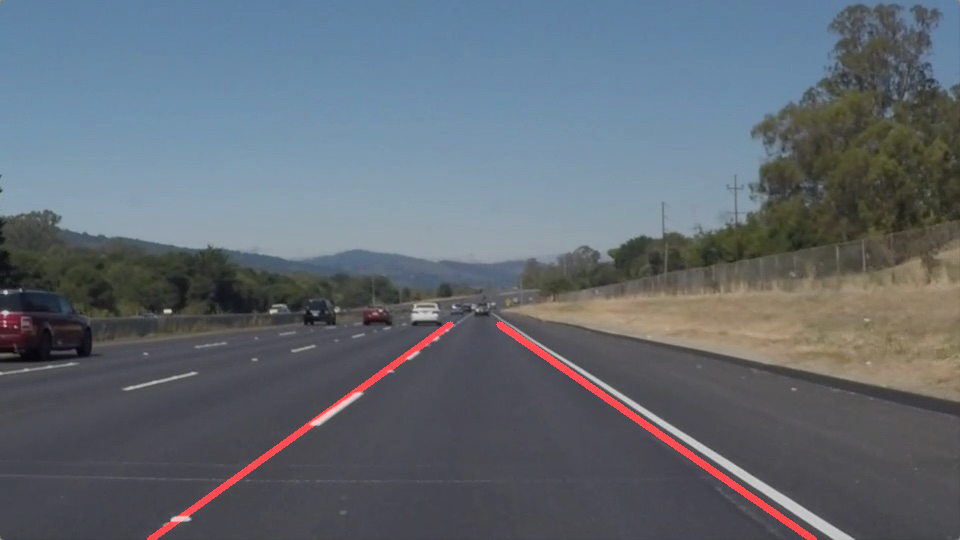
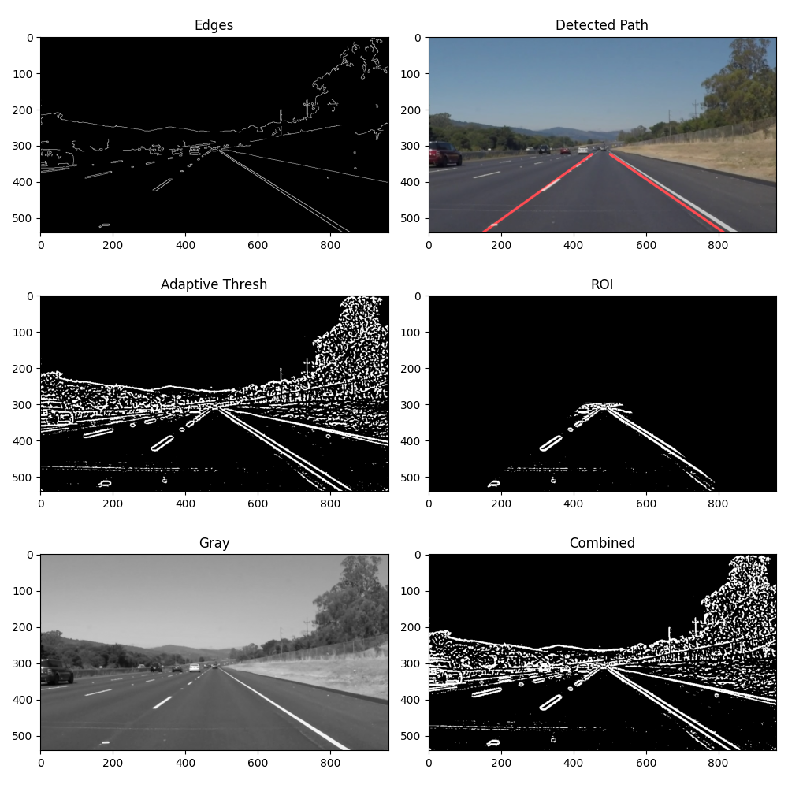

# Lane Detector

Finds the lane lines on a road in a photo or a video and draws them in red. Classic computer vision with OpenCV: no neural networks, just edges, a mask and line fitting.

<p align="center">
  
</p>

## How it works

Every image, or every video frame, goes through the same steps:

1. **Gray**: convert to grayscale and blur a little (Gaussian 5×5) to remove noise.
2. **Edges**: find sharp brightness changes with Canny (thresholds 50 and 150).
3. **Adaptive threshold**: separately, compare each pixel with the average of its small neighborhood instead of one global value. This keeps working when part of the road is in shadow.
4. **Combined**: merge both results into one edge image.
5. **ROI**: keep only a trapezoid in front of the car, where the lanes are. Trees, sky and other lanes are cut off.
6. **Lines**: find straight segments with the Hough transform. Drop nearly horizontal ones (|slope| < 0.3). Negative slope means the left lane, positive the right one. Fit one line per side with `polyfit` and draw it in red over the original frame.

<p align="center">
  
</p>

## Requirements

- **Python 3** with `opencv-python`, `numpy` and `matplotlib` (in `requirements.txt`)

## Run

In PowerShell, from the project folder:

```powershell
python -m venv venv
.\venv\Scripts\activate
pip install -r requirements.txt
```

```powershell
python lane_detector.py
```

It processes everything in `input/` and saves the results to `output/`:

| Input | Output |
|---|---|
| `input/image.jpg` | `output/output_detected.png` and `output/output_pipeline.png` (all steps) |
| `input/road.mp4` | `output/output_road.mp4` |
| `input/test_video.mp4` | `output/output_test_video.mp4` |

The videos play in a window while they're processed. Press `q` to skip to the next one.

## Demo videos

- [Road video](output/output_road.mp4)
- [Test video](output/output_test_video.mp4)

If a video doesn't play on GitHub, click **View raw** to download it.

## Code

Everything is in `lane_detector.py`:

```
process_image()       steps 1–6 for one image or frame
region_of_interest()  the trapezoid mask
draw_lines()          slope filter, left/right split, polyfit, red lines
show_pipeline()       the 6-panel picture of all steps
process_video()       runs process_image() on every frame and saves a video
```
